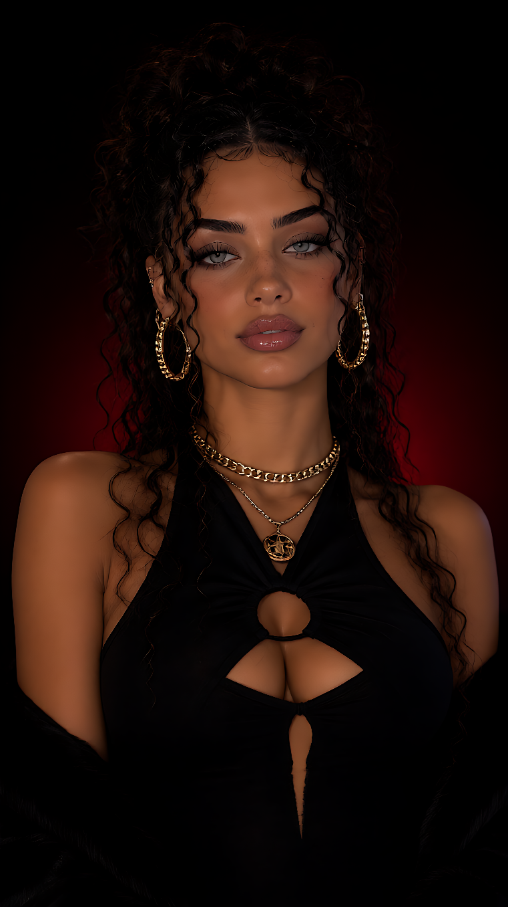
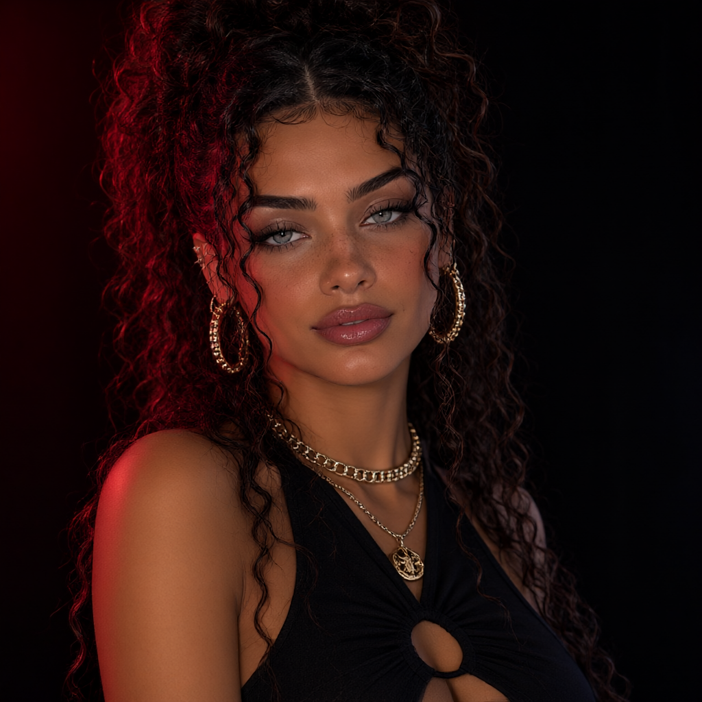

# 🎬 Daytona Studio — ton « Higgsfield » open source et illimité

Studio de création vidéo IA pour l'influenceuse virtuelle **Daytona**, basé sur **ComfyUI**
et uniquement des modèles **open source**. Tu l'installes sur ton propre GPU (ou un GPU loué),
et tu génères autant de vidéos que tu veux, sans crédits ni abonnement.

<p align="center">
   
</p>

## Ce que ça fait (équivalences Higgsfield)

| Higgsfield | Daytona Studio (onglet) | Modèle open source utilisé |
|---|---|---|
| **Recast** / remplacement de personnage | 🔁 *Remplace-moi* → « Garder mon décor » | **SCAIL-2** (Wan 2.1 14B) + **SAM 3.1** (détection automatique de la personne) |
| Recast + changement de décor | 🔁 *Remplace-moi* → « Nouveau décor généré » | **Wan-Animate-2** (le décor vient de ton texte) |
| **Speak** / avatar parlant, lip-sync | 🗣️ *Faire parler* | **InfiniteTalk** (Wan 2.1 I2V 14B), durée illimitée |
| Voix / clonage de voix | 🎙️ *Voix* | **Chatterbox Multilingual** (TTS FR + 22 langues) et **Chatterbox VC** (ta voix → voix de Daytona) |
| **Soul** / photos du personnage | 📸 *Photos* | **Qwen-Image-Edit 2511** (+ LoRA Lightning 4 étapes) |
| Image → vidéo (DoP) | 🎬 *Animer une photo* | **Wan 2.2 I2V 14B** (+ LoRA Lightx2v 4 étapes) |
| Changer le fond | 🖼️ *Changer le fond* | Qwen-Image-Edit (par texte) ou **BiRefNet** (détourage) |
| Upscale / fluidité | ✨ *Finitions* | **FILM** (x2 images/s), musique de fond ; SeedVR2 dans ComfyUI |

### Le flux « mon avatar me remplace totalement »

1. Tu te filmes (story, face caméra, danse, unboxing…).
2. Onglet **Remplace-moi** : l'IA trouve toute seule la personne dans ta vidéo (SAM 3.1),
   la remplace par Daytona **en gardant tes mouvements, tes expressions et ton lip-sync**.
3. Ta voix est convertie en **voix de Daytona** (même texte, même intonation, autre timbre).
4. Option : **nouveau décor** généré à partir d'un texte (« rooftop à Dubaï au coucher du soleil »).
5. Fluidité x2 → vidéo prête pour TikTok / Reels en 9:16.

Les vidéos longues sont gérées automatiquement : le studio découpe en segments de 81 images
et les enchaîne (raccords anti-saut de couleur inclus).

---

## 1. Matériel nécessaire

Ces modèles sont lourds (14 milliards de paramètres). Il faut une **carte NVIDIA**.

| Configuration | Ce qui marche |
|---|---|
| RTX 3090 / 4090 (24 Go VRAM), 64 Go de RAM | Tout en 480p (recommandé pour démarrer) |
| RTX 5090 (32 Go) ou L40S / A6000 (48 Go) | Tout, 720p confortable |
| H100 / A100 80 Go | Le plus rapide, 720p sans souci |
| Mac / PC sans NVIDIA / CPU | ❌ trop lent pour la vidéo → loue un GPU |

**Disque** : ~150 Go pour toutes les fonctions (tu peux n'installer que ce dont tu as besoin, voir plus bas).

> 💡 **Pas de GPU ?** Loue-en un à l'heure sur [RunPod](https://www.runpod.io), Vast.ai ou Massed Compute
> (une RTX 4090 coûte généralement quelques dizaines de centimes de l'heure). « Illimité » = pas de crédits :
> tu paies seulement le temps de GPU (ou ton électricité si c'est ta carte).

---

## 2. Installation

### Option A — RunPod / serveur Linux (le plus simple)

1. Crée un Pod avec une **RTX 4090** (ou mieux), template **PyTorch**, un *Volume* de **200 Go** monté sur `/workspace`,
   et expose les ports **8188** (ComfyUI) et **7860** (Studio).
2. Ouvre le terminal du Pod puis :

```bash
cd /workspace
git clone https://github.com/dianahilali3-prog/Daytona.git
cd Daytona
bash install/setup.sh            # installe ComfyUI + nœuds + télécharge tous les modèles (~150 Go)
bash install/start.sh            # démarre ComfyUI puis le Studio
```

3. Ouvre le port **7860** du Pod (bouton *Connect*) → c'est ton studio.
   Le port **8188** donne l'interface ComfyUI classique, avec tous les workflows dans *Workflows → Daytona*.

Installer seulement certaines fonctions :

```bash
python install/download_models.py --list                       # tailles par fonction
FEATURES="recast parler" bash install/setup.sh                 # ex. Recast + avatar parlant (~55 Go)
```

Fonctions : `recast`, `recast_fond`, `parler`, `photos`, `animer_photo`, `fond`, `fluidite`.

### Option B — PC Windows avec carte NVIDIA

1. Installe **ComfyUI Desktop** ou la version **portable** depuis https://www.comfy.org/download (prends la dernière version :
   SCAIL-2, Wan-Animate-2 et InfiniteTalk sont des nœuds natifs récents).
2. Installe [ffmpeg](https://www.gyan.dev/ffmpeg/builds/) et ajoute-le au PATH.
3. Dans ComfyUI → *Manager* → *Custom Nodes Manager*, installe **ComfyUI_Fill-ChatterBox**, puis redémarre.
4. Télécharge ce dépôt (bouton *Code → Download ZIP*), puis dans un terminal (avec le Python de ComfyUI) :

```bat
python install\download_models.py --comfy "C:\chemin\vers\ComfyUI"
python -m pip install -r studio\requirements.txt
cd studio
python app.py
```

5. Ouvre http://localhost:7860. (ComfyUI doit être lancé, sur le port 8188 par défaut ;
   sinon définis `set COMFY_URL=http://127.0.0.1:XXXX`.)

---

## 3. Préparer l'avatar (onglet 👤 Avatar)

- **Photos de référence** : les 2 photos de Daytona sont déjà dans `avatar/daytona/`.
  Ajoute 3-6 photos de plus (face, 3/4, profil, plan large) générées dans l'onglet *Photos* → la ressemblance sera bien meilleure.
- **Voix** : dépose un échantillon **de 10 à 30 s**, voix claire, sans musique ni écho. Il sert de « voix officielle »
  de Daytona pour le TTS et la conversion. Il doit s'agir d'une voix que tu as le droit d'utiliser
  (la tienne, une voix de synthèse que tu as créée, ou une personne qui a donné son accord).
  Astuce : génère plusieurs voix avec l'onglet *Voix*, garde celle que tu préfères et enregistre-la comme échantillon
  pour que Daytona ait toujours **la même voix**.
- **Description** (anglais) : utilisée dans les prompts vidéo pour garder le look (cheveux bouclés, yeux gris-bleu,
  bijoux dorés…). Déjà remplie, modifiable.

## 4. Conseils pour de bons résultats

**Remplace-moi (Recast)**
- Cadre ta vidéo **comme la photo de référence** (buste → photo buste ; plan pied → photo en pied).
- Bonne lumière, **une seule personne**, caméra pas trop secouée, visage bien visible.
- Pour une tenue précise : génère d'abord une photo de Daytona dans cette tenue (onglet *Photos*),
  puis mets-la dans *Options avancées → Tenue / look spécifique*.
- Teste d'abord **10 s en 480p**, puis passe en 720p pour la version finale.

**Faire parler**
- Écris le texte comme tu parles (ponctuation = respirations). « Émotion » à 0,6-0,8 pour un ton influenceuse dynamique.
- Photo de face ou 3/4, bouche fermée ou légèrement ouverte.

**Photos**
- Mets une **photo d'inspiration** (Pinterest, autre influenceuse…) dans « Scène / pose » : Daytona prend la place
  de la personne avec la même pose, tenue et décor. Ajoute des détails dans le texte pour changer la tenue ou le lieu.

**Transparence** : TikTok et Instagram demandent d'indiquer les contenus réalistes générés par IA
(étiquette « Contenu généré par IA »). Ne remplace jamais une autre personne réelle sans son accord.

---

## 5. Utiliser les workflows directement dans ComfyUI

Le dossier [`workflows/`](workflows) contient les workflows officiels Comfy-Org (licence MIT), prêts à glisser-déposer
dans ComfyUI (ils sont aussi copiés dans *Workflows → Daytona* par `setup.sh`) :

| Fichier | Usage |
|---|---|
| `01_recast_remplacer_personnage_SCAIL2.json` | Remplacement de personnage dans une vidéo |
| `02_recast_nouveau_fond_WanAnimate2.json` | Animation du personnage + décor par texte |
| `03_speak_lipsync_InfiniteTalk.json` | Avatar parlant (1 ou 2 personnes) |
| `04_speak_alternative_Wan22_S2V.json` | Alternative : Wan 2.2 Speech-to-Video |
| `05_photos_avatar_QwenEdit2511.json` | Photos avec références |
| `06_photo_vers_video_Wan22_I2V.json` | Image → vidéo |
| `07_voix_TTS_Chatterbox_multilingue.json` | Texte → voix clonée |
| `08_voix_conversion_Chatterbox_VC.json` | Conversion de voix |
| `09_detourage_fond_BiRefNet.json` | Détourage |
| `10_fluidite_interpolation_FILM.json` | Interpolation d'images |
| `11_upscale_video_SeedVR2.json` | Upscale vidéo (SeedVR2) |

## 6. Organisation du dépôt

```
avatar/daytona/        photos de référence, voix, profile.json (description du personnage)
install/               setup.sh, start.sh, download_models.py, models.json (liens et tailles des modèles)
studio/                app.py (interface Gradio), graphs.py (graphes ComfyUI), comfy_client.py, media.py (ffmpeg)
studio/templates/      workflows officiels convertis au format API
workflows/             workflows ComfyUI (format interface)
tools/                 validate_graphs.py (vérifie les graphes sur un ComfyUI), convert_templates.js
outputs/               tes créations (créé automatiquement, ignoré par git)
```

Le Studio ne fait que piloter ComfyUI par son API : tout reste local, rien n'est envoyé à un service externe
(à part le téléchargement initial des modèles depuis Hugging Face).

## 7. Dépannage

| Problème | Solution |
|---|---|
| « ComfyUI ne répond pas » | Lance `bash install/start.sh` (ou ComfyUI à la main) et vérifie `COMFY_URL`. |
| `value not in list` sur un modèle | Le modèle n'est pas téléchargé : `python install/download_models.py --features …`. |
| Node `WanSCAILToVideo` / `WanAnimate2ToVideo` inconnu | ComfyUI trop ancien : `git -C ComfyUI pull` puis `pip install -r ComfyUI/requirements.txt`. |
| Manque de mémoire (OOM) | Reste en 480p, réduis la durée max, ou lance ComfyUI avec `COMFY_ARGS="--lowvram"`. |
| Visage pas assez ressemblant | Ajoute des photos de référence nettes, cadre ta vidéo comme la référence. |
| Voix robotique | Échantillon de voix plus propre (sans bruit), émotion entre 0,4 et 0,8. |
| Vérifier l'installation | `python tools/validate_graphs.py` : envoie chaque graphe à ComfyUI et affiche OK/ÉCHEC. |

## 8. Licences

Code de ce dépôt : MIT. Workflows : © Comfy Org, MIT (`workflows/LICENSE-…`).
Chaque modèle a sa propre licence (Wan, Qwen-Image, Chatterbox : Apache 2.0 / MIT ; SCAIL-2, SAM 3.1, InfiniteTalk :
voir leur page Hugging Face). **Vérifie la licence de chaque modèle avant un usage commercial** (placements de produits, etc.).
